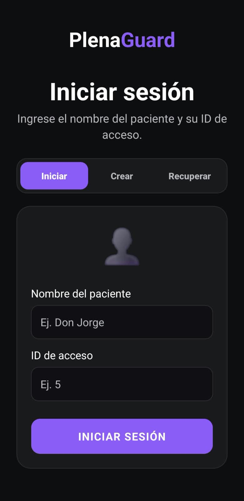
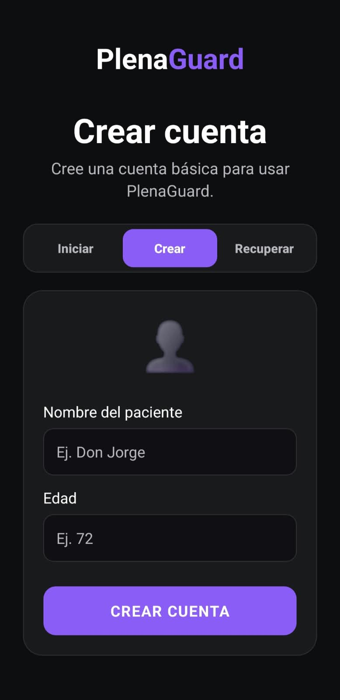
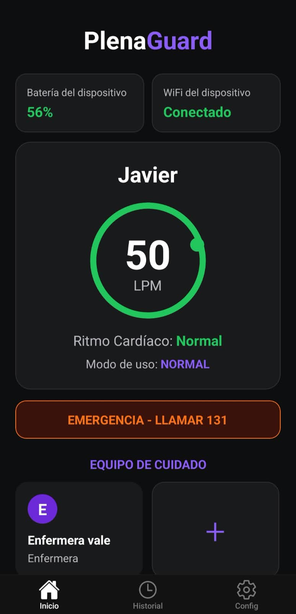
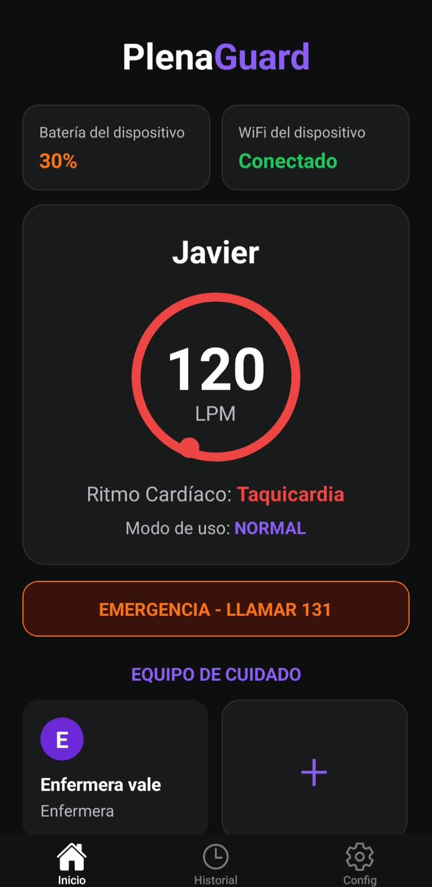
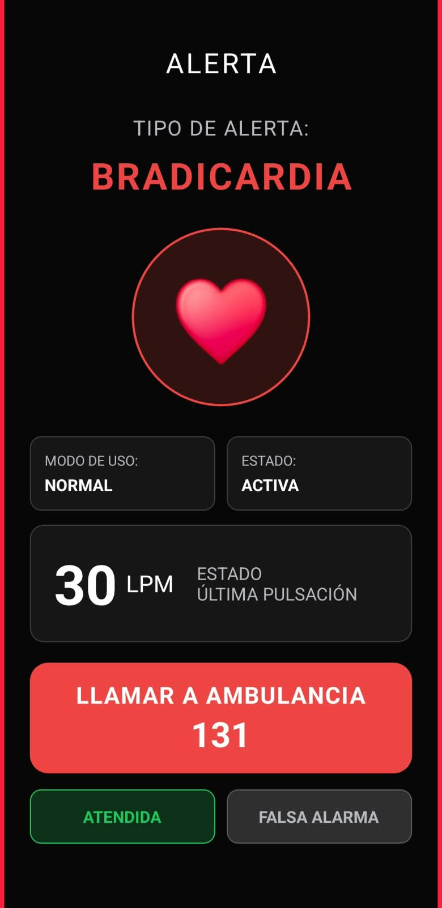
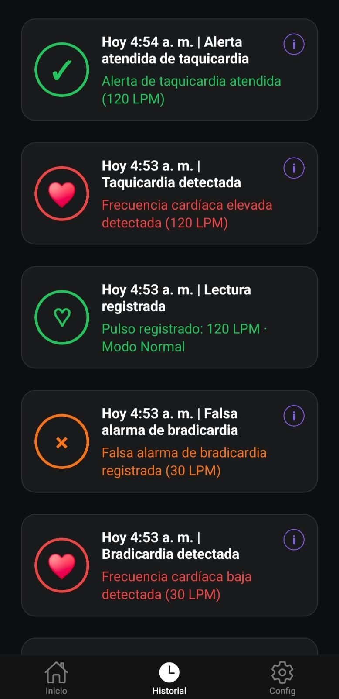

# PlenaGuard

**Sistema de monitoreo y alerta temprana para el cuidado de adultos mayores**

PlenaGuard es un proyecto académico desarrollado durante el **primer semestre de 2026** en la Universidad Diego Portales (UDP), en el marco del curso Proyecto en TICS. Integra una pulsera inteligente basada en ESP32, un backend, una base de datos en la nube y una aplicación móvil para que familiares o cuidadores puedan supervisar a distancia el estado de una persona mayor.

---

## Contexto y problema

En Chile existe una población creciente de adultos mayores que vive sola. Frente a un evento crítico (una arritmia, un infarto o una caída), muchas soluciones disponibles dependen de que la persona active manualmente un botón de pánico, algo que no es posible si se desmaya o no puede moverse. Por otro lado, los dispositivos comerciales que sí detectan estos eventos (relojes inteligentes y servicios de teleasistencia) tienen un costo elevado para gran parte de la población.

PlenaGuard propone una alternativa de **bajo costo y operación pasiva**: el adulto mayor solo porta la pulsera, y el sistema se encarga de medir, evaluar y avisar.

## Objetivo

Desarrollar una plataforma que permita **detectar oportunamente anomalías en la frecuencia cardíaca y posibles caídas**, y que **notifique a la red de apoyo** del paciente mediante una aplicación móvil sencilla, reduciendo el tiempo de respuesta ante una emergencia.

---

## Mi participación

Mi trabajo en el proyecto abarcó tanto la gestión del equipo como el desarrollo técnico:

- **Organización y cumplimiento de plazos:** organicé el trabajo del equipo y di seguimiento a los avances para asegurar que se cumplieran los tiempos de entrega establecidos.
- **Desarrollo Full Stack:** desarrollé la **aplicación móvil**, el **backend** y la **base de datos**, asumiendo el rol de desarrollador Full Stack y encargándome de la integración entre las tres capas.
- **Diseño de la aplicación:** estuve a cargo del diseño de la interfaz de usuario, buscando una experiencia clara, coherente y simple de usar tanto para el familiar como para el cuidador.
- **Estructuración de la información:** velé por que la información del proyecto se estructurara bajo estándares técnicos, garantizando la legibilidad lógica y la consistencia con los objetivos del proyecto, lo que facilitó su exposición y comprensión ante distintas audiencias.

---

## Funcionamiento general

1. La **pulsera** mide la frecuencia cardíaca (sensor óptico PPG) y la aceleración (acelerómetro/giroscopio) y envía los datos por WiFi.
2. El **backend** recibe, valida y almacena la información en la base de datos.
3. La **aplicación móvil** consulta el backend y muestra el estado actual, el historial y las alertas.
4. Ante un evento crítico, el familiar o cuidador puede **llamar a emergencias (131)**, marcar la alerta como **atendida** o como **falsa alarma**, y registrar el contexto del evento.

### Lógica de detección

| Situación | Criterio |
|---|---|
| Rango normal en reposo | 60 a 100 LPM |
| Anomalía cardíaca | Lectura fuera de rango, confirmada en **3 lecturas consecutivas** y con el usuario en reposo, para reducir falsas alarmas |
| Modo deporte | Los umbrales se ajustan según la edad del paciente mediante la fórmula de Tanaka (`HRmax = 208,75 − 0,7 · edad`) |
| Caída | Análisis de la magnitud del vector de aceleración (ingravidez, impacto, inactividad y cambio de orientación) |

---

## Componentes de la solución

| Componente | Descripción |
|---|---|
| **Aplicación móvil** | Interfaz para consultar el estado del paciente, revisar el historial, gestionar alertas y contactos de emergencia, y acceder a la configuración. |
| **Backend** | API REST que procesa las solicitudes de la app y centraliza la lógica del sistema. La app nunca accede directamente a la base de datos. |
| **Base de datos** | Almacenamiento relacional de pacientes, dispositivos, lecturas, alertas, contactos y contexto de alertas. |
| **Dispositivo de monitoreo** | Pulsera con ESP32-C3, sensor MAX30102 (pulso) y MPU6050 (movimiento y caídas), alimentada por batería LiPo con módulo de carga TP4056. |

### Arquitectura

```text
┌──────────────────┐      ┌────────────────────┐      ┌─────────────────────┐
│  App móvil       │ ───► │  Backend (API)     │ ───► │  Base de datos      │
│  React Native    │      │  Node.js + Express │      │  PostgreSQL         │
│  + Expo          │ ◄─── │  desplegado en     │ ◄─── │  (Supabase)         │
└──────────────────┘      │  Render            │      └─────────────────────┘
                          └─────────▲──────────┘
                                    │ WiFi
                          ┌─────────┴──────────┐
                          │  Pulsera ESP32     │
                          │  MAX30102 + MPU6050│
                          └────────────────────┘
```

Esta separación en capas permite modificar la interfaz, la lógica o el almacenamiento de forma independiente, y facilita agregar más adelante autenticación real, roles y permisos por paciente.

### Modelo de datos

Tablas principales: `pacientes`, `dispositivos`, `lecturas`, `alertas`, `contactos_emergencia` y `contexto_alertas`. Un paciente se asocia a un dispositivo, el cual genera lecturas y alertas; cada alerta puede tener un contexto asociado (actividad realizada, síntomas, confirmación y observaciones).

---

## Tecnologías

| Capa | Tecnologías |
|---|---|
| Aplicación móvil | React Native, Expo |
| Backend | Node.js, Express, despliegue en Render |
| Base de datos | PostgreSQL mediante Supabase |
| Hardware | ESP32-C3, MAX30102, MPU6050, batería LiPo, TP4056 |
| Firmware | C++ (Arduino Core) |

---

## Capturas de la aplicación

### Inicio de sesión

El acceso se realiza con el nombre del paciente y su ID de acceso.

<p align="center">
  
</p>

### Creación de cuenta

Registro básico del paciente mediante su nombre y edad. La edad se utiliza para ajustar los umbrales de frecuencia cardíaca.

<p align="center">
  
</p>

### Pantalla principal

Muestra la frecuencia cardíaca actual, el estado del ritmo, el modo de uso, la batería y la conexión WiFi del dispositivo, además de un acceso directo a emergencias (131) y el equipo de cuidado. Se muestran dos estados: lectura normal y taquicardia.

<p align="center">
  
  &nbsp;&nbsp;
  
</p>

### Alerta de bradicardia

Pantalla de alerta crítica con el tipo de evento, el modo de uso, el estado de la alerta y la última pulsación registrada. Permite llamar a una ambulancia o marcar la alerta como atendida o falsa alarma.

<p align="center">
  
</p>

### Historial

Registro cronológico de lecturas y alertas, diferenciadas visualmente por tipo y estado (detectada, atendida o falsa alarma).

<p align="center">
  
</p>

<!-- Pendiente: agregar capturas de Configuración, contactos de emergencia y reporte PDF
     en la carpeta screenshots/ y referenciarlas aquí. -->

---

## Funcionalidades principales

- Visualización en tiempo casi real de la frecuencia cardíaca, batería y conexión del dispositivo.
- Clasificación de alertas (bradicardia, taquicardia y caída) con su estado de gestión.
- Historial de lecturas y alertas.
- Registro de contexto por alerta (actividad, síntomas, confirmación y observaciones).
- Gestión de contactos de emergencia.
- Acceso rápido a la llamada de emergencia (131).
- Cambio entre modo normal y modo deporte.
- Generación de registro cardíaco en PDF por rango de fechas.

---

## Estructura del repositorio

```text
PlenaGuard-personal/
├── plenaguard-app/    # Aplicación móvil (React Native + Expo)
├── backend/           # API y lógica del servidor (Node.js + Express)
├── DB/                # Scripts y recursos de la base de datos
├── ESP32/             # Código del dispositivo
├── firmware_esp32/    # Firmware del microcontrolador
├── main.cpp           # Código principal del dispositivo
├── screenshots/       # Capturas utilizadas en este README
└── README.md
```

---

## Ejecución

Cada componente tiene sus propias dependencias y variables de entorno:

```bash
# Backend
cd backend
npm install
npm start

# Aplicación móvil
cd plenaguard-app
npm install
npx expo start
```

Las variables de entorno (por ejemplo, las credenciales de Supabase) deben definirse en un archivo `.env` local dentro de `backend/`. **No publiques credenciales, tokens ni archivos `.env` en el repositorio.**

---

## Estado del proyecto y trabajo futuro

PlenaGuard es un **prototipo funcional** con fines académicos, orientado a validar la comunicación entre dispositivo, backend, base de datos y aplicación. No constituye un dispositivo médico ni cuenta con validación clínica.

Aspectos pendientes para una versión productiva:

- Autenticación real (Supabase Auth con JWT) y políticas de Row Level Security para que cada cuidador acceda solo a los datos de su paciente.
- Almacenamiento seguro de sesiones en el teléfono (Expo SecureStore) y registro de auditoría en el backend.
- Diseño de una PCB a medida para reducir el tamaño del dispositivo.
- Carcasa sellada, resistente a salpicaduras y a impactos leves.
- Mayor optimización del consumo energético para extender la autonomía.
- Reducir la dependencia de la conexión a internet para el envío de alertas remotas (por ejemplo, con reintentos automáticos).

---

**PlenaGuard — Proyecto académico, primer semestre de 2026 · Universidad Diego Portales**
